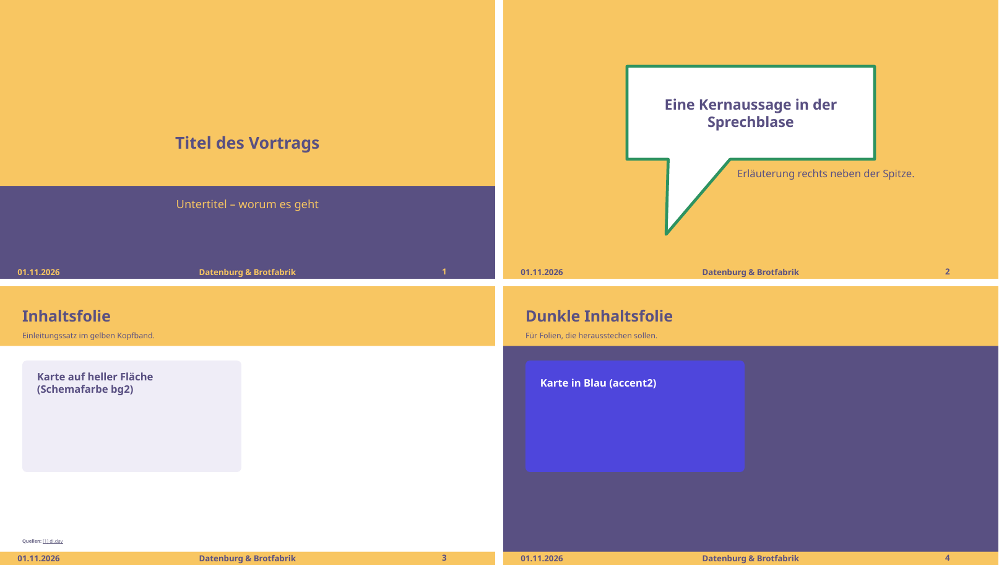

# did-theme-template

DIDAY-Theme für [pptxgenjs](https://gitbrent.github.io/PptxGenJS/): Farben,
Schrift und Masterfolien nach der Präsentationsvorlage des
[Digital Independence Day](https://di.day/) (`Diday-vorlage_v1.3`). Damit
lassen sich DI-Day-Vorträge als Code schreiben und als PowerPoint und PDF
bauen. Sie sehen dann aus wie mit der offiziellen Vorlage gemacht.



*Inoffiziell: Dies ist kein Projekt des Digital Independence Day.*

## Was drin ist

- **Farben** der Vorlage als Theme-Palette der PPTX: Gelb `#F8C662`, Lila
  `#595082`, Blau `#4E46DC`, Grün `#2E9361`, dazu helle und gedämpfte Töne
  für Karten und Nebentexte (`THEME.colors`).
- **Schrift** Noto Sans für Überschriften und Text.
- **Vier Masterfolien** im Format 16:9, Maße aus der Vorlage übernommen:

  | Master | Aussehen | Platzhalter |
  |---|---|---|
  | `TITEL` | oben Gelb mit großem Logo, unten Lila | `title`, `body`, `quelle` |
  | `AUSSAGE` | Kernaussage in grün umrandeter Sprechblase auf Gelb | `title`, `body`, `quelle` |
  | `INHALT` | weiß, gelbes Kopfband mit Titel und Einleitung | `title`, `lead`, `quelle` |
  | `INHALT_DUNKEL` | wie `INHALT`, aber auf Lila | `title`, `lead`, `quelle` |

- **Fußzeile** wie in der Vorlage: Datum links, Text in der Mitte, Seitenzahl
  rechts.

## Benutzen

Voraussetzung: Node 22 oder neuer, `pptxgenjs` (≥ 4) und `sharp` im eigenen
Projekt. Die Datei `did-theme-template.js` ins Projekt kopieren oder das Repo
als Abhängigkeit einbinden:

```bash
pnpm add pptxgenjs sharp github:bmmmm/did-theme-template
```

```js
const pptxgen = require("pptxgenjs");
const did = require("did-theme-template"); // oder "./did-theme-template"

(async () => {
  const pres = new pptxgen();
  await did.setup(pres, {
    date: "01.11.2026",
    footer: "Datenburg & Brotfabrik",
    logo: "diday-logo.svg", // optional, siehe unten
  });

  const titel = pres.addSlide({ masterName: did.MASTER.TITEL });
  titel.addText("Passwörter und Zwei-Faktor", { placeholder: "title" });
  titel.addText("Nach den Wechselrezepten von di.day", { placeholder: "body" });

  const s = pres.addSlide({ masterName: did.MASTER.INHALT });
  s.addText("Was macht ein Passwortmanager?", { placeholder: "title" });
  s.addText("Stell ihn dir vor wie einen Tresor.", { placeholder: "lead" });
  s.addText([
    { text: "Quellen: ", options: { bold: true } },
    { text: "[1] BSI", options: { hyperlink: { url: "https://www.bsi.bund.de/" }, color: did.QUELLE_COLOR.INHALT } },
  ], { placeholder: "quelle" });

  await pres.writeFile({ fileName: "vortrag.pptx" });
  await did.finish("vortrag.pptx"); // Farbpalette und Sprechblase – nicht vergessen
})();
```

- `did.setup(pres, { date, footer, logo })` setzt Format, Schriften und
  Masterfolien. Der Aufruf muss vor dem ersten `addSlide` stehen.
- `did.finish(datei)` muss nach `writeFile` laufen. pptxgenjs übernimmt aus
  `pres.theme` nur die Schriften und kennt in Mastern nur Rechtecke.
  `finish` schreibt deshalb die Farbpalette ins Theme und formt die
  Sprechblase.
- Danach zeigen die Schemafarben von pptxgenjs (`pres.SchemeColor.accent1` …)
  auf die DIDAY-Farben.
- `did.QUELLE_COLOR[master]` ist die Farbe der Quellenzeile. Gib sie Links
  mit, dann übernimmt PowerPoint sie statt des Theme-Linkblaus, das auf Lila
  und Gelb schlecht lesbar ist.

Ein vollständiges Beispiel mit je einer Folie pro Master steht in
[`beispiel/beispiel.js`](beispiel/beispiel.js):

```bash
pnpm install
pnpm run beispiel                     # beispiel/beispiel.pptx
pnpm run beispiel -- diday-logo.svg   # mit Logo
```

## Logo

Das DIDAY-Logo ist **nicht** in diesem Repo, denn es gehört dem Digital
Independence Day und steht nicht unter einer offenen Lizenz. Wer die
offizielle Vorlage hat, findet es darin: Die `.otp` ist ein ZIP-Archiv, das
Logo liegt unter `Pictures/` als SVG.

```bash
unzip -j Diday-vorlage_v1.3.otp 'Pictures/*.svg' -d logo/
```

Den Pfad (oder einen Buffer mit SVG/PNG) als `logo` an `setup` übergeben.
Ohne `logo` bleiben die Plätze frei.

## PDF

Zum Beispiel mit LibreOffice:
`soffice --headless --convert-to pdf vortrag.pptx`. Für den richtigen
Zeilenfall muss Noto Sans installiert sein (Debian/Ubuntu: `fonts-noto-core`).
Sonst setzt LibreOffice eine andere Schrift ein, und Texte brechen anders um.

## Entwickeln

```bash
pnpm install
pnpm test        # baut das Beispiel mit und ohne Logo und prüft Palette, Master, Sprechblase, Fußzeile
```

Im Einsatz für den Vortrag „Passwörter und Zwei-Faktor – einfach sicher“:
<https://bmmmm.github.io/talks/did-passwordmanagers-2026/>

## English

Unofficial [pptxgenjs](https://gitbrent.github.io/PptxGenJS/) theme that
reproduces the slide template of Germany's Digital Independence Day
(di.day): palette, Noto Sans and four slide masters (title, statement
callout, content, dark content) with the template's footer.

- Call `did.setup(pres, { date, footer, logo })` before adding slides.
- Call `did.finish(file)` after `writeFile`.
- The DIDAY logo is not included; pass your own copy via `logo`.

## Lizenz

Code: [Apache-2.0](LICENSE). Farben und Maße sind der Vorlage des Digital
Independence Day nachempfunden. Name und Logo „DIDAY“ gehören dem Digital
Independence Day.
